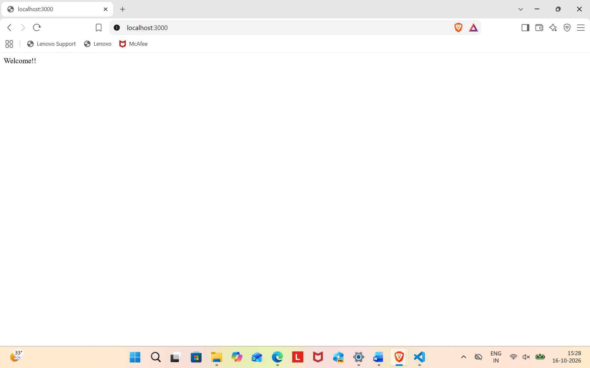
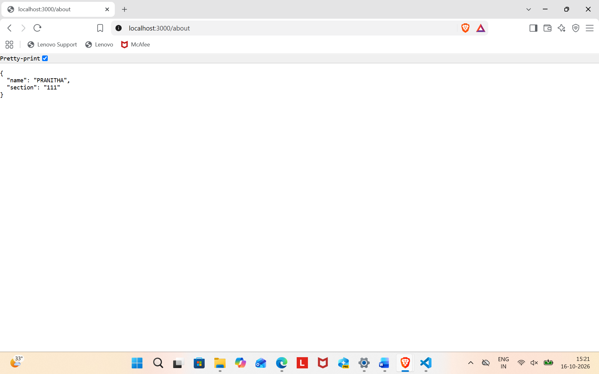
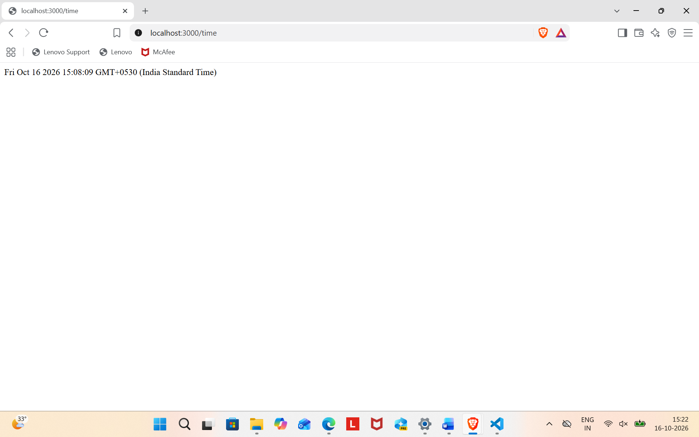
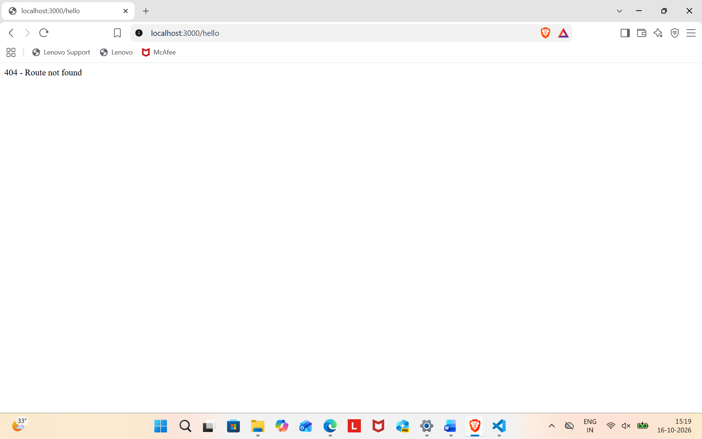

# Lab 1: Node.js and Express server

Name: N PRANITHA · Registration Number: 252U1R9110  · Section:111

Live link: https://bdf-lab-01-wzlq.onrender.com

## How to run

1. Install the packages:
   npm install
2. Start the server:
   npm start
3. Open http://localhost:3000 in the browser.

No environment variables are required.

## Endpoints

| Method | Path   | Description                                   |
|--------|--------|-----------------------------------------------|
| GET    | /      | Returns the welcome text                      |
| GET    | /about | Returns JSON with name and section            |
| GET    | /time  | Returns the current date and time             |
| GET    | any other path | Returns a 404 "Route not found" message |

## Status codes observed

| Route | Status code |
|-------|-------------|
| /     | 200 OK      |
| /about | 200 OK     |
| /time | 200 OK      |
| /hello (unknown path) | 404 Not Found |

## Screenshots

## Notes

- Problem: the browser showed "Cannot GET /hello" instead of my custom 404 message.
- Solution: I had not restarted the server after adding the 404 handler. Restarting with `npm start` fixed it.
- The 404 handler must be placed after all the routes, otherwise it would catch every request first.
