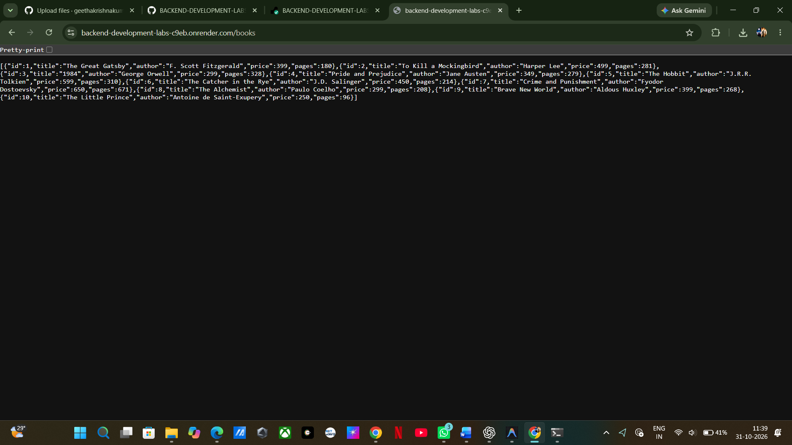
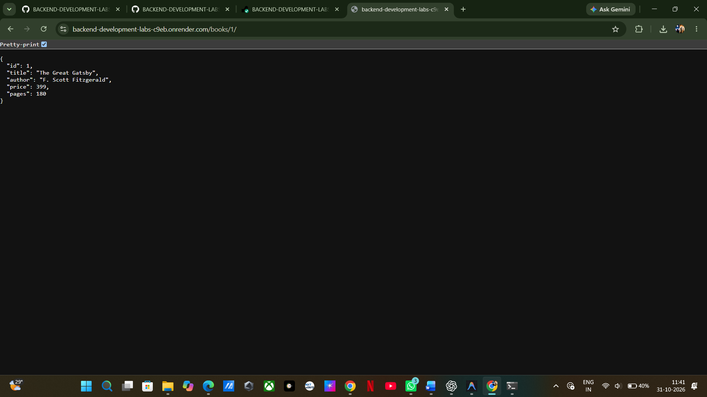
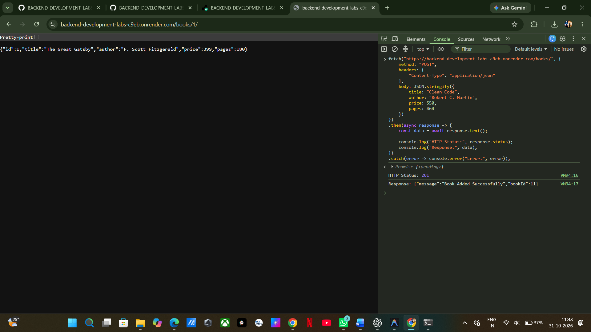
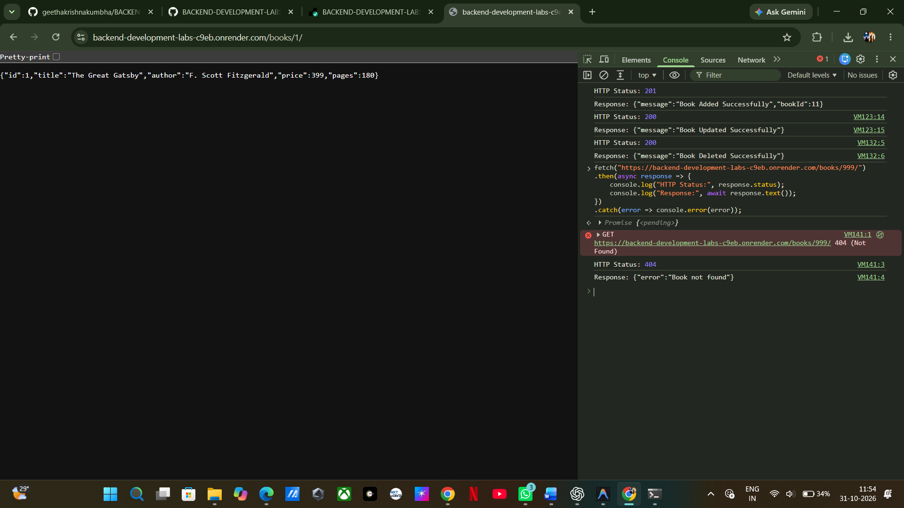

# Lab 2: SQLite Database and CRUD Routes

## Student Details

* **Name:** N. Pranitha
* **Registration Number:** 252U1R9110
* **Section:** CSE GEN-AI
* **Course:** Backend Development Fundamentals
* **Lab Number:** 02

---

## Live Demo & Deployment Note

**Live URL:** https://bdf-labs-02-dryz.onrender.com

---

## Aim

To create an SQLite database named `books.db` inside `database/`, define a `book` table with appropriate attributes, insert 10 initial book records using the SQLite CLI, and develop a full-featured RESTful CRUD API using Node.js and Express.js. The server initializes the database connection asynchronously before listening for requests and handles all CRUD operations using secure parameterized SQL queries (`?` placeholders) with appropriate HTTP status codes.

---

## Technologies Used

* **Node.js** — JavaScript server runtime environment.
* **Express.js** — Fast, unopinionated web framework for Node.js.
* **SQLite** — Lightweight, serverless relational database engine.
* **sqlite** & **sqlite3** — Node.js SQLite client wrappers providing Promise-based database access (`open`, `db.all`, `db.get`, `db.run`).
* **Nodemon** — Development utility that monitors for code changes and automatically restarts the server.
* **JavaScript (ES6+)** — Programming language.
* **npm** — Package manager for Node.js.

---

## Project Structure

```text
lab-02/
├── database/
│   ├── books.db           <-- SQLite database file (committed to repository)
│   └── schema.sql         <-- SQL table schema & initial CLI insert script
├── screenshots/           <-- Postman / client test screenshots
│   ├── .gitkeep
│   ├── get-all-books.png
│   ├── get-single-book.png
│   ├── post-add-book.png
│   ├── put-update-book.png
│   ├── delete-book.png
│   └── not-found.png
├── node_modules/          <-- Generated dependencies (ignored via .gitignore)
├── .gitignore             <-- Ignores node_modules/ and .env
├── package.json           <-- Project scripts & dependencies
├── package-lock.json      <-- Dependency lockfile
├── server.js              <-- Main Express application entry point
├── verify-endpoints.js    <-- Automated end-to-end endpoint & DB test suite
└── README.md              <-- Complete lab documentation & viva prep
```

---

## Database Schema & CLI Initialization

### Table Definition

The `book` table is structured as follows:

```sql
CREATE TABLE book (
  id INTEGER PRIMARY KEY,
  title TEXT,
  author TEXT,
  price INTEGER,
  pages INTEGER
);
```

### Initial Data Inserted via SQLite CLI

As required, 10 initial records were inserted using the SQLite CLI:

| id | title | author | price | pages |
| :---: | :--- | :--- | :---: | :---: |
| 1 | The Great Gatsby | F. Scott Fitzgerald | 399 | 180 |
| 2 | To Kill a Mockingbird | Harper Lee | 499 | 281 |
| 3 | 1984 | George Orwell | 299 | 328 |
| 4 | Pride and Prejudice | Jane Austen | 349 | 279 |
| 5 | The Hobbit | J.R.R. Tolkien | 599 | 310 |
| 6 | The Catcher in the Rye | J.D. Salinger | 450 | 214 |
| 7 | Crime and Punishment | Fyodor Dostoevsky | 650 | 671 |
| 8 | The Alchemist | Paulo Coelho | 299 | 208 |
| 9 | Brave New World | Aldous Huxley | 399 | 268 |
| 10 | The Little Prince | Antoine de Saint-Exupery | 250 | 96 |

### SQLite CLI Commands

To inspect or interact with the database directly using the SQLite CLI:

```bash
# Open database file in SQLite CLI
sqlite3 database/books.db

# View tables
.tables

# View table schema
.schema book

# Enable formatted table display
.mode table
.headers on

# Query existing books
SELECT * FROM book;

# Exit SQLite CLI
.quit
```

---

## Installation and Setup

### Prerequisites

* Node.js (v18 or higher recommended)
* npm
* Postman, Thunder Client, or cURL

### Step 1: Navigate to the Lab Directory

```bash
cd BACKEND-DEVELOPMENT-LABS/lab-02
```

### Step 2: Install Dependencies

```bash
npm install
```

Installed packages:
* `express`
* `sqlite`
* `sqlite3`
* `nodemon` (devDependencies)

### Step 3: Run the Server

**Using standard Node.js:**
```bash
npm start
```

**Using Nodemon (development mode with auto-restart):**
```bash
npm run dev
```

The server initializes the database connection asynchronously via `initializeDBAndServer()` and starts listening:
```text
Server running on http://localhost:3000
```

### Step 4: Run Automated Tests

To execute the 21 automated integration tests covering all routes, input validations, 404 handlers, and database mutations:

```bash
npm test
```

---

## API Endpoints Specification

| HTTP Method | Endpoint | Description | SQL Method | Success Status | Error Statuses |
| :--- | :--- | :--- | :--- | :---: | :---: |
| **GET** | `/books/` | Retrieve all book records | `db.all()` | `200 OK` | `500 Internal Server Error` |
| **GET** | `/books/:bookId/` | Retrieve a particular book by its ID | `db.get()` | `200 OK` | `404 Not Found`, `500` |
| **POST** | `/books/` | Insert a new book record | `db.run()` | `201 Created` | `400 Bad Request`, `500` |
| **PUT** | `/books/:bookId/` | Update an existing book record by ID | `db.run()` | `200 OK` | `400 Bad Request`, `404 Not Found`, `500` |
| **DELETE** | `/books/:bookId/` | Delete an existing book record by ID | `db.run()` | `200 OK` | `404 Not Found`, `500` |

---

### Detailed Endpoint Documentation & Examples

#### 1. Retrieve All Books
* **Method:** `GET`
* **URL:** `http://localhost:3000/books/`
* **Description:** Retrieves all books from the database ordered by `id`.
* **Status Code:** `200 OK`
* **Example Response:**
```json
[
  {
    "id": 1,
    "title": "The Great Gatsby",
    "author": "F. Scott Fitzgerald",
    "price": 399,
    "pages": 180
  },
  {
    "id": 2,
    "title": "To Kill a Mockingbird",
    "author": "Harper Lee",
    "price": 499,
    "pages": 281
  }
]
```

#### 2. Retrieve a Specific Book
* **Method:** `GET`
* **URL:** `http://localhost:3000/books/1/`
* **Description:** Retrieves a single book matching the route parameter `:bookId`.
* **Success Status Code:** `200 OK`
* **Success Response:**
```json
{
  "id": 1,
  "title": "The Great Gatsby",
  "author": "F. Scott Fitzgerald",
  "price": 399,
  "pages": 180
}
```
* **Not Found Status Code:** `404 Not Found` (e.g., `GET /books/999/`)
```json
{
  "error": "Book not found"
}
```

#### 3. Insert a New Book
* **Method:** `POST`
* **URL:** `http://localhost:3000/books/`
* **Description:** Validates incoming JSON payload and inserts a new book record.
* **Headers:** `Content-Type: application/json`
* **Request Body:**
```json
{
  "title": "Clean Code",
  "author": "Robert C. Martin",
  "price": 799,
  "pages": 464
}
```
* **Success Status Code:** `201 Created`
* **Success Response:**
```json
{
  "message": "Book Added Successfully",
  "bookId": 11
}
```
* **Validation Error Status Code:** `400 Bad Request` (if title, author, price, or pages are missing)
```json
{
  "error": "Missing required fields: title, author, price, and pages are required"
}
```

#### 4. Update an Existing Book
* **Method:** `PUT`
* **URL:** `http://localhost:3000/books/11/`
* **Description:** Validates input, confirms book exists, and updates book details.
* **Headers:** `Content-Type: application/json`
* **Request Body:**
```json
{
  "title": "Clean Code: A Handbook of Agile Software Craftsmanship",
  "author": "Robert C. Martin",
  "price": 849,
  "pages": 464
}
```
* **Success Status Code:** `200 OK`
* **Success Response:**
```json
{
  "message": "Book Updated Successfully"
}
```
* **Not Found Status Code:** `404 Not Found` (if book with `:bookId` does not exist)
```json
{
  "error": "Book not found"
}
```

#### 5. Delete an Existing Book
* **Method:** `DELETE`
* **URL:** `http://localhost:3000/books/11/`
* **Description:** Checks if book exists, then deletes it from the database.
* **Success Status Code:** `200 OK`
* **Success Response:**
```json
{
  "message": "Book Deleted Successfully"
}
```
* **Not Found Status Code:** `404 Not Found` (if book with `:bookId` does not exist)
```json
{
  "error": "Book not found"
}
```

---

## Screenshots

Add your Postman or browser screenshots to the `screenshots/` directory using the corresponding filenames:

### 1. GET /books/ (Retrieve All Books)


### 2. GET /books/:bookId/ (Retrieve Single Book)


### 3. POST /books/ (Add New Book)


### 4. PUT /books/:bookId/ (Update Book)


### 5. DELETE /books/:bookId/ (Delete Book)


### 6. Unknown Path / 404 Handling


---

## Concepts Learned

1. **Relational Database Management with SQLite:**
   * Designing tables with appropriate data types (`INTEGER`, `TEXT`, `REAL`).
   * Primary key generation and auto-increment behavior.
   * Creating and seeding database files directly via the SQLite CLI.

2. **Asynchronous Server & Database Initialization:**
   * Understanding why the Express server must not accept traffic until the database connection has successfully resolved via `async/await`.
   * Structuring a single async function (`initializeDBAndServer()`) for clean startup orchestration and error handling.

3. **Secure SQL Queries (Parameterized Queries):**
   * Using SQL `?` placeholders instead of string concatenation or template literals.
   * Protecting backend applications against SQL Injection (SQLi) attacks.

4. **REST API Design & HTTP Status Codes:**
   * Mapping HTTP verbs (`GET`, `POST`, `PUT`, `DELETE`) to database CRUD operations.
   * Distinguishing status codes: `200 OK`, `201 Created`, `400 Bad Request`, `404 Not Found`, and `500 Internal Server Error`.

5. **Express Middleware:**
   * Utilizing `express.json()` to parse incoming JSON payloads into `req.body`.
   * Implementing catch-all 404 route handlers for undefined endpoints.

---

## Viva Preparation & Questions

### 1. What is SQLite and how does it differ from client-server databases like MySQL or PostgreSQL?
**Answer:** SQLite is an embedded, serverless, self-contained relational database management system. Rather than running as a separate service communicating over network sockets (like MySQL or PostgreSQL), SQLite reads and writes directly to an ordinary file on the local disk. It requires zero configuration, has minimal memory footprint, and is ideal for embedded systems, development, and lightweight applications.

### 2. What is the difference between `db.all()`, `db.get()`, and `db.run()` in the `sqlite` driver?
**Answer:**
* **`db.all(query, [params])`**: Executes a `SELECT` statement and returns a Promise that resolves to an **array of all matching row objects** (or an empty array `[]` if no rows match).
* **`db.get(query, [params])`**: Executes a `SELECT` statement and resolves to only the **first matching row object** (or `undefined` if no row matches). Used for single-record lookups (e.g. by primary key).
* **`db.run(query, [params])`**: Executes data modification statements (`INSERT`, `UPDATE`, `DELETE`, `CREATE`). It does not return row data, but provides metadata such as `result.lastID` (the auto-generated primary key from an `INSERT`) and `result.changes` (the number of affected rows).

### 3. What is SQL Injection and how do parameterized queries (`?` placeholders) prevent it?
**Answer:** SQL Injection is a security vulnerability where an attacker manipulates SQL commands by injecting malicious SQL statements through input fields (e.g., using string concatenation like `'SELECT * FROM book WHERE id = ' + bookId`). 
Parameterized queries separate the query structure from the user-supplied data: the query string with `?` is compiled by the database engine first, and the values in the parameters array are bound strictly as data literals, rendering injected SQL syntax inert.

### 4. Why must the Express server start only after the database connection succeeds?
**Answer:** In asynchronous Node.js applications, starting the server before establishing a valid database connection can result in incoming HTTP requests hitting database query handlers while the database instance (`db`) is still `null` or uninitialized. This would lead to unhandled exceptions, server crashes, or 500 errors. Initializing inside `initializeDBAndServer()` ensures that `app.listen()` is only called once `db` is fully operational.

### 5. What are the appropriate HTTP status codes for CRUD operations?
**Answer:**
* `200 OK`: Successful retrieval (`GET`), update (`PUT`), or deletion (`DELETE`).
* `201 Created`: Successful creation of a new resource (`POST`).
* `400 Bad Request`: Client sent malformed data or failed input validation (e.g., missing required fields).
* `404 Not Found`: Requested resource or endpoint does not exist.
* `500 Internal Server Error`: Unhandled server-side or database driver error.

### 6. What is the difference between `PUT` and `PATCH`?
**Answer:** `PUT` is typically used for full resource replacement (the client submits the entire resource entity), whereas `PATCH` is designed for partial updates (the client submits only the specific fields to be modified).

---

## Problems Faced and Solutions

1. **Database Readiness Before Listening:**
   * *Problem:* Calling `app.listen()` synchronously caused queries to fail if a request arrived before SQLite finished opening the database file.
   * *Solution:* Implemented `initializeDBAndServer()` as an `async` function using `await open(...)` before invoking `app.listen()`.

2. **Accurate 404 Detection on Non-Existent Records:**
   * *Problem:* Executing `UPDATE` or `DELETE` with a non-existent ID does not throw an SQL syntax error, which could mislead the API into returning `200 OK` even though nothing was modified.
   * *Solution:* Checked if the book exists using `db.get()` prior to performing `db.run()`, ensuring an explicit `404 Not Found` response is returned when the ID is invalid.

3. **Preventing SQLite Lock and File Exclusion:**
   * *Problem:* Committing `.db` files can occasionally be prevented by overzealous `.gitignore` rules.
   * *Solution:* Verified that `.gitignore` strictly ignores `node_modules/` and `.env`, while ensuring `database/books.db` remains tracked and committed as required by faculty guidelines.

---

## GitHub Submission Checklist

- [x] Lab 2 created completely inside `lab-02/` without altering `lab-01/`.
- [x] SQLite database `database/books.db` created and pre-loaded with 10 sample books via SQLite CLI.
- [x] `server.js` implements `initializeDBAndServer()` and all five required CRUD routes.
- [x] Parameterized queries (`?`) used throughout all SQL operations.
- [x] All 21 automated integration tests pass (`npm test`).
- [x] `books.db` is NOT ignored in `.gitignore` and is ready to be committed.
- [x] `node_modules/` and `.env` are excluded via `.gitignore`.
- [ ] Postman screenshots captured and saved to `lab-02/screenshots/`.
- [ ] Changes staged, committed, and pushed to GitHub:
  ```bash
  git add lab-02/
  git commit -m "Complete Lab 2: SQLite Database and CRUD Routes"
  git push origin main
  ```

---

**Lab 02 completed:** SQLite Database and CRUD Routes.

